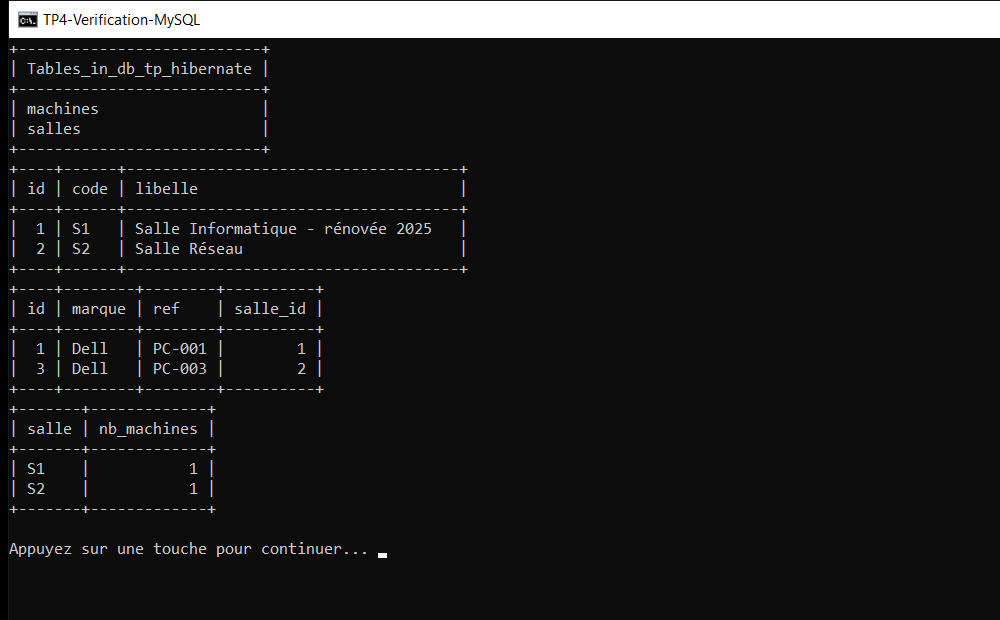

# TP 4 — Hibernate & persistance des données

Mapper des objets Java sur des tables MySQL, puis manipuler la base uniquement
au travers d'un **DAO générique** et de requêtes **HQL**.

> Lab du cours *Architecture Microservices : Conception, Déploiement et Orchestration* (MLIAEdu).
> Stack : Hibernate ORM 5.6.15.Final · `javax.persistence` 2.2 · MySQL Connector/J 8.0.33 · JUnit 5.
> Base : MySQL/MariaDB locale (`db_tp_hibernate`).

## Résultat attendu (exécution réelle)


Le scénario `app.Demo` déroule six étapes contre la vraie base et compare, à chaque fois,
la valeur attendue et la valeur réellement obtenue :

| Étape | Vérification | Attendu | Obtenu |
|-------|--------------|---------|--------|
| 1 | Identifiants générés par la base (`GenerationType.IDENTITY`) | `S1=1` … `PC-004=4` | `S1=1`, `PC-004=4` |
| 1 | Une machine est reliée à sa salle par `salle_id` | S1 contient 2 machines | 2 |
| 2 | Relecture par clé primaire puis mise à jour du libellé | `Salle Informatique - rénovée 2025` | identique |
| 2 | Changement d'affectation de `PC-002` vers `S3` | `S1=1`, `S3=2` | `S1=1`, `S3=2` |
| 3 | `findByMarque("dell")` — HQL paramétrée, insensible à la casse | `PC-001`, `PC-003` | `PC-001`, `PC-003` |
| 3 | Répartition des machines par salle — `group by` | `S1=1 \| S2=1 \| S3=2` | `S1=1 \| S2=1 \| S3=2` |
| 3 | Jointure `left join fetch` : collections chargées hors session | 3 salles initialisées | 3 |
| 3 | `salleLaPlusEquipee()` — tri par agrégat | `S3` (2 machines) | `S3` |
| 4 | Code de salle en double via la couche service | rejet métier | `IllegalArgumentException` |
| 4 | Code de salle en double via le DAO (contrainte `uk_salle_code`) | `insertion=false`, salles inchangées | salles = 3 |
| 4 | Machine sans salle | rejet métier | `IllegalArgumentException` |
| 4 | Clé étrangère `salle_id` invalide | `insertion=false`, machines inchangées | machines = 4 |
| 5 | Suppression de `S3` et cascade sur ses machines | 4 → 2 machines | 4 → 2 |
| — | **Total** | **21 vérifications conformes** | **21 / 21** |

Transcription complète de la sortie console (les instructions SQL produites par
`hibernate.show_sql=true` sont retirées pour la lisibilité, le fichier source de cette
transcription est [docs/transcription-console.txt](docs/transcription-console.txt)) :

```text
[WARN] HHH10001002: Using Hibernate built-in connection pool (not for production use!)
==========================================================================================
 TP 4 - Hibernate et persistance des données
 Mapping objet-relationnel, DAO générique et requêtes HQL
==========================================================================================
 JDK          : 25.0.2 (Eclipse Adoptium)
 Hibernate    : 5.6.15.Final
 Base         : jdbc:mysql://localhost:3306/db_tp_hibernate?useSSL=false&allowPublicKeyRetrieval=true&serverTimezone=UTC&useUnicode=true&characterEncoding=UTF-8
==========================================================================================

[0] Purge des données précédentes
--------------------------------------------------------------------------------
  [OK]    Table salles vidée                             | 0 salle(s)
  [OK]    Table machines vidée                           | 0 machine(s)

[1] Création des salles puis des machines (clé étrangère salle_id)
--------------------------------------------------------------------------------
  -> Salle#1 S1 "Salle Informatique" créée=true
  -> Salle#2 S2 "Salle Réseau" créée=true
  -> Salle#3 S3 "Salle Électronique" créée=true
  -> Machine#1 PC-001 (Dell) -> salle S1
  -> Machine#2 PC-002 (HP) -> salle S1
  -> Machine#3 PC-003 (Dell) -> salle S2
  -> Machine#4 PC-004 (Lenovo) -> salle S3
  [OK]    Identifiants générés par la base               | S1=1, PC-004=4
  [OK]    3 salles persistées                            | 3 salle(s)
  [OK]    4 machines persistées                          | 4 machine(s)
  [OK]    Machine reliée à sa salle en base              | S1 contient 2 machine(s)

[2] Lecture par identifiant, mise à jour et changement d'affectation
--------------------------------------------------------------------------------
  getById(1)   -> Salle#1 S1 "Salle Informatique"
  deplacer PC-002 vers S3 -> true
  [OK]    Lecture par clé primaire                       | code lu = S1
  [OK]    Mise à jour du libellé                         | "Salle Informatique - rénovée 2025"
  [OK]    Changement de salle pris en compte             | S1=1, S3=2

[3] Requêtes HQL : recherche paramétrée, agrégations, jointure
--------------------------------------------------------------------------------
  findByMarque("dell") -> PC-001, PC-003
  repartition par salle -> S1=1 | S2=1 | S3=2
  S1  "Salle Informatique - rénovée 2025"      1 machine(s) chargée(s) par join fetch
  S2  "Salle Réseau"                           1 machine(s) chargée(s) par join fetch
  S3  "Salle Électronique"                     2 machine(s) chargée(s) par join fetch
  salleLaPlusEquipee() -> S3 (2 machines)
  [OK]    Recherche HQL insensible à la casse            | 2 machine(s) de marque Dell
  [OK]    Agrégation group by                            | S3 = 2 machine(s)
  [OK]    Jointure chargée en une requête                | 3 salle(s) avec collection initialisée
  [OK]    Tri par agrégat                                | S3

[4] Validation métier et rollback sur violation de contrainte
--------------------------------------------------------------------------------
  service.create("S1") -> rejet : Le code de salle S1 est déjà utilisé
  [OK]    Code de salle unique (service)                 | Le code de salle S1 est déjà utilisé
[WARN] SQL Error: 1062, SQLState: 23000
[ERROR] Duplicate entry 'S1' for key 'uk_salle_code'
[DAO] Rollback délaissé (IllegalStateException) : la transaction a déjà été annulée par Hibernate
[DAO] Échec pendant la création de Salle#0 S1 "Doublon tenté en direct" : Duplicate entry 'S1' for key 'uk_salle_code'
  [OK]    Contrainte SQL uk_salle_code + rollback        | insertion=false, salles=3
  machine sans salle -> rejet : Une machine doit être rattachée à une salle persistée
  [OK]    Machine toujours rattachée à une salle         | Une machine doit être rattachée à une salle persistée
[WARN] SQL Error: 1452, SQLState: 23000
[ERROR] Cannot add or update a child row: a foreign key constraint fails (`db_tp_hibernate`.`machines`, CONSTRAINT `FKquovysu2pi8pvqec0isp62e4r` FOREIGN KEY (`salle_id`) REFERENCES `salles` (`id`))
[DAO] Rollback délaissé (IllegalStateException) : la transaction a déjà été annulée par Hibernate
[DAO] Échec pendant la création de Machine#0 PC-999 (Asus) -> salle SX : Cannot add or update a child row: a foreign key constraint fails (`db_tp_hibernate`.`machines`, CONSTRAINT `FKquovysu2pi8pvqec0isp62e4r` FOREIGN KEY (`salle_id`) REFERENCES `salles` (`id`))
  [OK]    Clé étrangère salle_id appliquée               | insertion=false, machines=4

[5] Suppression d'une salle et cascade sur ses machines
--------------------------------------------------------------------------------
  delete(S3) -> true ; machines avant=4, après=2
  [OK]    Salle supprimée                                | parCode("S3") = null
  [OK]    Machines de S3 supprimées en cascade           | 4 -> 2 machine(s)
  [OK]    Machines restantes rattachées aux bonnes salles | S1=1, S2=1
  [OK]    Nombre final de salles                         | 2 salle(s)

==========================================================================================
 BILAN : 21 vérification(s) conforme(s) sur 21
 État du projet : toutes les couches (entités, DAO, services) fonctionnent.
==========================================================================================
```

## Vérification côté base



État réel des tables à la fin du scénario (la salle `S3` et ses deux machines ont été
supprimées par la cascade de l'étape 5, il reste donc 2 salles et 2 machines) :

```text
+---------------------------+
| Tables_in_db_tp_hibernate |
+---------------------------+
| machines                  |
| salles                    |
+---------------------------+
+----+------+-------------------------------------+
| id | code | libelle                             |
+----+------+-------------------------------------+
|  1 | S1   | Salle Informatique - rénovée 2025   |
|  2 | S2   | Salle Réseau                        |
+----+------+-------------------------------------+
+----+--------+--------+----------+
| id | marque | ref    | salle_id |
+----+--------+--------+----------+
|  1 | Dell   | PC-001 |        1 |
|  3 | Dell   | PC-003 |        2 |
+----+--------+--------+----------+
+-------+-------------+
| salle | nb_machines |
+-------+-------------+
| S1    |           1 |
| S2    |           1 |
+-------+-------------+
```

## Structure du projet

```text
tp4-hibernate-persistance/
├── pom.xml
├── run-demo.cmd                     # lance la démo dans une console UTF-8
├── docs/
│   ├── screenshots/
│   │   ├── console-execution.png
│   │   └── verification-mysql.png
│   └── transcription-console.txt    # sortie console complète (sans le SQL)
├── src/main/java/
│   ├── entities/
│   │   ├── Salle.java               # @OneToMany (cascade ALL, LAZY)
│   │   └── Machine.java             # @ManyToOne (salle_id)
│   ├── dao/
│   │   ├── IDao.java                # contrat générique create/update/delete/getById/getAll
│   │   ├── DaoSupport.java          # rollback + journalisation des échecs
│   │   ├── SalleDao.java            # + findByCode, getAllAvecMachines, salleLaPlusEquipee
│   │   └── MachineDao.java          # + findByMarque, findBySalle, compterParSalle, répartition
│   ├── services/
│   │   ├── SalleService.java        # validation métier + purge
│   │   └── MachineService.java      # validation métier + déplacement d'une machine
│   ├── util/HibernateUtil.java      # SessionFactory unique, surcharges DB_*
│   └── app/Demo.java                # scénario vérifié, code de sortie 0/1
├── src/main/resources/hibernate.cfg.xml
└── src/test/java/
    ├── services/SalleServiceTest.java
    ├── services/MachineServiceTest.java
    └── dao/DaoPersistanceTest.java
```

## Modèle de données

Deux tables suffisent à illustrer l'association `1..n` : une **salle** regroupe plusieurs
**machines**, et chaque machine appartient obligatoirement à une salle.

```text
salles                                  machines
+----+------+---------+                 +----+--------+--------+----------+
| id | code | libelle |                 | id | marque | ref    | salle_id |
+----+------+---------+                 +----+--------+--------+----------+
        ^                                              |
        +----------------------------------------------+
                   FOREIGN KEY (salle_id) REFERENCES salles(id)
```

| Contrainte | Rôle |
|------------|------|
| `uk_salle_code UNIQUE(code)` | deux salles ne peuvent pas partager le même code |
| `uk_machine_ref UNIQUE(ref)` | une référence de machine est unique dans tout le parc |
| `FOREIGN KEY (salle_id)` | une machine ne peut pas exister sans salle |
| `ON DELETE` géré par Hibernate | `cascade = CascadeType.ALL` + `orphanRemoval` sur `Salle.machines` |

Déclaration côté entités :

```java
@Entity
@Table(name = "salles", uniqueConstraints = @UniqueConstraint(name = "uk_salle_code", columnNames = "code"))
public class Salle {
    @Id @GeneratedValue(strategy = GenerationType.IDENTITY)
    private int id;

    @OneToMany(mappedBy = "salle", cascade = CascadeType.ALL, orphanRemoval = true, fetch = FetchType.LAZY)
    private List<Machine> machines = new ArrayList<>();
    // ...
}

@Entity
@Table(name = "machines", uniqueConstraints = @UniqueConstraint(name = "uk_machine_ref", columnNames = "ref"))
public class Machine {
    @ManyToOne(fetch = FetchType.EAGER, optional = false)
    @JoinColumn(name = "salle_id", nullable = false)
    private Salle salle;
    // ...
}
```

Le schéma est créé automatiquement au premier démarrage (`hibernate.hbm2ddl.auto=update`) :

```sql
create table salles (
   id integer not null auto_increment,
    code varchar(20) not null,
    libelle varchar(120) not null,
    primary key (id)
) engine=InnoDB;

create table machines (
   id integer not null auto_increment,
    marque varchar(60) not null,
    ref varchar(30) not null,
    salle_id integer not null,
    primary key (id)
) engine=InnoDB;
```

## Couche DAO et services

Le contrat est volontairement minimal : les couches supérieures ne connaissent que
`IDao<T>`, jamais `Session`, `Transaction` ni `Query`.

```java
public interface IDao<T> {
    boolean create(T objet);
    boolean update(T objet);
    boolean delete(T objet);
    T getById(int id);
    List<T> getAll();
}
```

Chaque implémentation suit le même schéma : `try`-with-resources sur la `Session`,
transaction explicite, `commit` en cas de succès et `rollback` dans le `catch`.

```java
@Override
public boolean create(Salle salle) {
    Transaction transaction = null;
    try (Session session = HibernateUtil.getSessionFactory().openSession()) {
        transaction = session.beginTransaction();
        session.save(salle);
        transaction.commit();
        return true;
    } catch (Exception e) {
        DaoSupport.rollback(transaction);
        DaoSupport.signalerEchec("la création de " + salle, e);
        return false;
    }
}
```

Les services ajoutent les règles métier avant d'appeler le DAO (double barrière : validation
applicative *et* contraintes SQL) : code de salle unique, machine obligatoirement rattachée
à une salle persistée, champs obligatoires.

## Requêtes HQL utilisées

| Usage | Requête HQL |
|-------|-------------|
| Lister les salles | `from Salle order by code` |
| Rechercher par code | `from Salle where code = :code` |
| Inventaire avec collections | `select distinct s from Salle s left join fetch s.machines order by s.code` |
| Salle la plus équipée | `select s from Salle s left join s.machines m group by s.id, s.code, s.libelle order by count(m) desc, s.code asc` |
| Rechercher par marque | `from Machine m where lower(m.marque) = lower(:marque) order by m.ref` |
| Compter par salle | `select count(m) from Machine m where m.salle.id = :salleId` |
| Répartition par salle | `select s.code, count(m) from Salle s left join s.machines m group by s.code order by s.code asc` |
| Vider une table | `delete from Machine` / `delete from Salle` |

## Prérequis et configuration

1. **JDK 17+** (testé avec JDK 21 et 25) et **Maven 3.6+**.
2. **MySQL ou MariaDB** démarré sur le port 3306 (XAMPP, WAMP, MySQL Server…).
3. La base doit exister — les tables, elles, sont créées par Hibernate :

```sql
CREATE DATABASE IF NOT EXISTS db_tp_hibernate
  CHARACTER SET utf8mb4 COLLATE utf8mb4_general_ci;
```

Configuration de la connexion ([src/main/resources/hibernate.cfg.xml](src/main/resources/hibernate.cfg.xml)) :

| Propriété | Valeur par défaut |
|-----------|-------------------|
| `hibernate.connection.url` | `jdbc:mysql://localhost:3306/db_tp_hibernate?useSSL=false&allowPublicKeyRetrieval=true&serverTimezone=UTC&useUnicode=true&characterEncoding=UTF-8` |
| `hibernate.connection.username` | `root` |
| `hibernate.connection.password` | *(vide — défaut XAMPP)* |
| `hibernate.dialect` | `org.hibernate.dialect.MySQL8Dialect` |
| `hibernate.hbm2ddl.auto` | `update` |
| `hibernate.show_sql` / `format_sql` | `true` |

Aucun identifiant n'est codé en dur dans le code Java : la configuration peut être
surchargée sans modifier le fichier XML (variable d'environnement ou `-D`) :

```bat
set DB_URL=jdbc:mysql://localhost:3306/db_tp_hibernate?serverTimezone=UTC
set DB_USER=root
set DB_PASSWORD=secret
```

## Construire, lancer, tester

```bat
mvn clean package
run-demo.cmd
```

`run-demo.cmd` vérifie la présence d'un JDK 17+, configure la console en UTF-8 (accents et
SQL lisibles) et transmet les paramètres nécessaires à Hibernate. Sinon, directement :

```bat
java -Dfile.encoding=UTF-8 -cp "target\classes;target\lib\*" app.Demo
```

Le scénario renvoie un **code de sortie 0** si les 21 vérifications passent, `1` sinon :
il est donc utilisable tel quel dans une chaîne d'intégration.

Tests de non-régression (JUnit 5, base réelle, purge automatique avant chaque test) :

```bat
mvn test
```

```text
Tests run: 19, Failures: 0, Errors: 0, Skipped: 0
```

| Classe de test | Couverture |
|----------------|------------|
| `services.SalleServiceTest` (7) | création, relecture, tri, mise à jour, suppression, code en double, libellé vide |
| `services.MachineServiceTest` (7) | rattachement à une salle, machine orpheline, référence en double, `findByMarque`, répartition, déplacement, cascade |
| `dao.DaoPersistanceTest` (5) | rollback sur contrainte, clé étrangère, `getById` inconnu, `join fetch`, salle la plus équipée |

> ⚠️ La démo comme les tests **purgent les tables** au démarrage : `db_tp_hibernate` est une
> base de travaux pratiques, pas une base de production.

## Points techniques vérifiés

- **Instance détachée et cascade** — supprimer une `Salle` dont la collection `machines`
  n'a jamais été chargée laisse les machines en base et provoque une erreur de clé
  étrangère. `SalleDao.delete` recharge donc l'entité dans la session avant de la
  supprimer : c'est la cascade qui s'applique, pas la collection vide de l'objet Java.
- **`LAZY` + session fermée** — `LazyInitializationException` si l'on parcourt `salle.getMachines()`
  après la fermeture de la `Session`. La méthode `getAllAvecMachines()` répond au problème
  avec `left join fetch` : une seule requête, collections initialisées.
- **`GenerationType.IDENTITY`** — l'`INSERT` part immédiatement au `save()`, l'identifiant
  est donc disponible avant le `commit` (visible dans la sortie : `Salle#1 … créée=true`).
- **Rollback** — dès qu'une requête SQL échoue, Hibernate marque la transaction comme
  annulable : aucune ligne partielle ne reste en base, les compteurs des étapes 4 le prouvent.
- **Double validation** — la couche service rejette un code de salle déjà utilisé avec un
  message lisible ; si l'on court-circuite le service, la contrainte `uk_salle_code` renvoie
  `Duplicate entry 'S1' for key 'uk_salle_code'`. Les deux niveaux sont testés.
- **UTF-8 de bout en bout** — base en `utf8mb4`, chaîne de connexion en `characterEncoding=UTF-8`,
  console en code page 65001 : les libellés accentués s'affichent correctement.

## Choix par rapport à l'énoncé

| Élément | Énoncé du TP | Ce projet |
|---------|--------------|-----------|
| Harnais d'exécution | `test/MainTest` avec `System.out.println` | `app.Demo` : 6 étapes, 21 vérifications attendu/obtenu, bilan et code de sortie |
| Couche DAO | `SalleDao`, `MachineDao` | idem + `DaoSupport` (rollback/journalisation) et requêtes HQL supplémentaires |
| Couche service | création / lecture / suppression | idem + validation, déplacement de machine, inventaire avec jointure, statistiques |
| Tests | un seul `SalleServiceTest` | 3 classes, 19 tests, isolation par purge |
| Reproducibilité | identifiants croissants | purge + remise à zéro des compteurs `AUTO_INCREMENT` |

Hibernate 5.6 et `javax.persistence` sont conservés pour rester fidèle au TP ; le code compile
et s'exécute sans modification sur un JDK récent (17 → 25).
