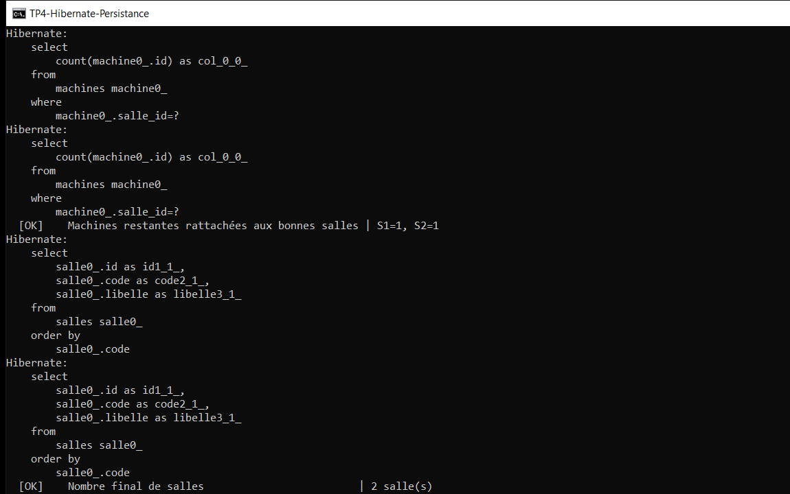

# TP 4 — Hibernate & persistance des données

Mapper des objets Java sur des tables MySQL, puis manipuler la base uniquement
au travers d'un **DAO générique** et de requêtes **HQL**.

## Résultat attendu (exécution réelle)

